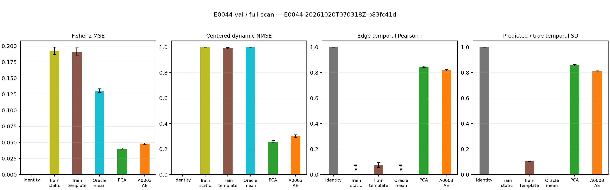
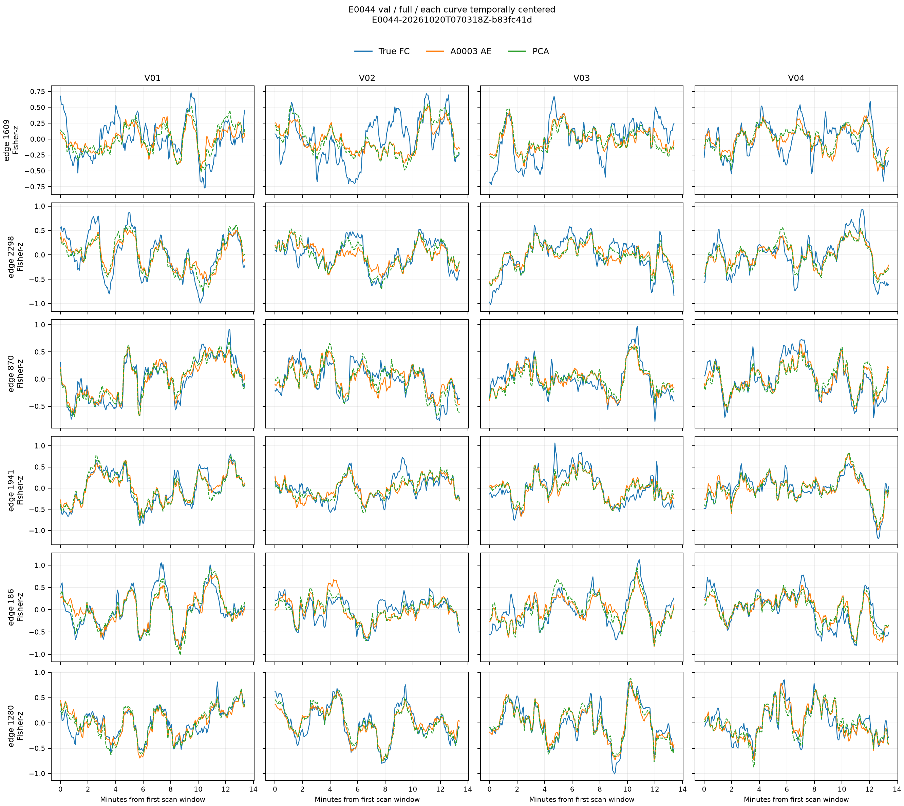

# E0044 frozen A0003 reconstruction diagnostic

Diagnostic ID: `E0044-20261020T070318Z-b83fc41d`. Completed on 2026-10-20, 15:03:18–15:22:10 Asia/Shanghai. This is contemporaneous FC reconstruction, not future forecasting. The A0003 checkpoint is frozen and verified against SHA256 `2228c6d742c1eb3225eb550ae3839b7be55cbaac8a9bfafa018780a0d961ec97`.

All 738 training LR runs and 158 validation LR runs have 224 windows and 4005 edges. PCA-256 and group references use training data only. Test FC data were not read. The diagnostic did not create a training run or update training-run counts.

## Validation results

Full-scan metrics are subject-weighted means. Confidence intervals use 10,000 subject bootstrap resamples, seed 20261020.

| Metric | A0003 AE | PCA-256 |
| --- | ---: | ---: |
| Fisher-z MSE | 0.048269 | 0.040538 |
| Spatial Pearson r | 0.872404 | 0.890396 |
| Temporal Pearson r | 0.819205 | 0.846038 |
| Mean edge temporal SD ratio | 0.810943 | 0.859003 |
| Centered dynamic NMSE | 0.303237 | 0.258927 |
| First-difference temporal r | 0.784183 | 0.824175 |

AE full-scan dynamic NMSE is 0.303237 (95% CI 0.293619–0.313035). The primary paired AE-minus-PCA difference is +0.044310 (95% CI +0.043531 to +0.045105), favoring PCA. The mean edge temporal SD ratio has 95% CI 0.806498–0.815348 for AE. All FC edges are temporally valid at the specified threshold; AE has no near-constant reconstructed edges in this interval.

The FC[20:224] target-aligned interval gives similar results: AE temporal r 0.818361, SD ratio 0.810110, dynamic NMSE 0.304298; PCA values are 0.845526, 0.859498, and 0.259486. On the actual K=20 input interval FC[0:20], AE temporal r is 0.736588 and its energy-weighted SD ratio is 0.793313. The mean edge SD ratio there is 0.872441; these are different aggregation rules, not interchangeable amplitude estimates.

## Interpretation

A0003 retains substantial contemporaneous temporal structure and shows moderate amplitude attenuation. It does not reconstruct FC as the nearly flat curves observed in downstream forecasting. That observation does not prove the frozen representation is optimal for prediction: E0040–E0043 use only the encoder and an independent prediction head, whereas this diagnostic also uses the original AE decoder.

PCA-256 reconstructs better on the primary paired measure. PCA was fitted on all training windows, while the existing AE training implementation samples 32 windows per training run; this comparison does not isolate linear versus nonlinear architecture. A useful next step is a frozen-latent probe or a PCA-history forecasting control, followed by checks of history utilization and the forecast objective. The diagnostic is COMPLETED; causal attribution of forecast smoothing remains INCONCLUSIVE.

## Figures and reproduction

Blue is the true FC trajectory, orange is A0003 reconstruction, and dashed green is PCA reconstruction. The curve examples use four fixed randomly selected validation subjects with display aliases, and six edges selected using training-only temporal variance. The examples are descriptive; the numerical table summarizes all 158 validation subjects.





Six PNGs, a rebuild script, and a visual manifest are stored here. Immutable computation inputs, per-run/per-subject CSVs, the PCA artifact, and selected private example arrays are under `../diagnostics/E0044-20261020T070318Z-b83fc41d/`. The result bundle was checked for publication on 2026-10-21 under the user's push request: tables contain study subject IDs and diagnostic metrics, figures use display aliases, and PCA/group artifacts contain fitted parameters and training aggregates. The example NPZ contains real selected FC values and remains excluded from Git. Rebuilding the curves requires that local private file.

```powershell
C:\ProgramData\miniconda3\envs\fmri\python.exe outputs/E0044/visual/E0044-20261020T070318Z-b83fc41d_rebuild.py
```

Reproduction uses the frozen renderer copied into the diagnostic directory and requires the local private example arrays. Existing diagnostic outputs are never overwritten by a new diagnostic run; use a new diagnostic ID for a new execution.
