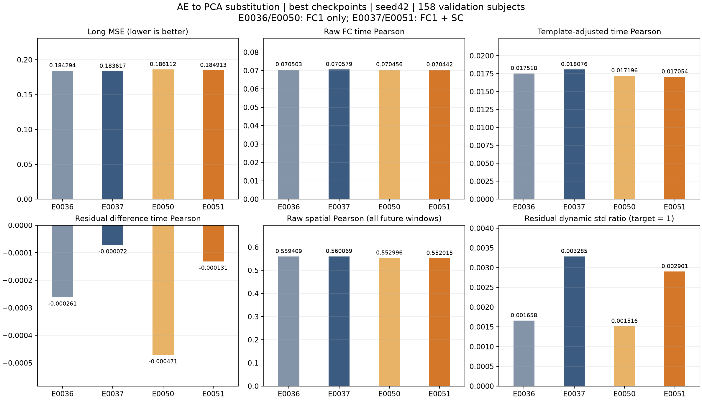
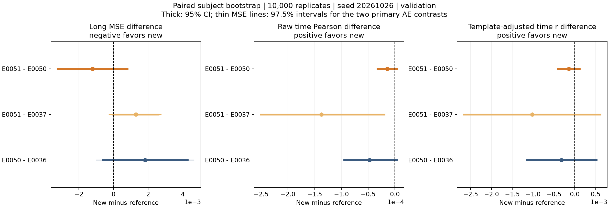
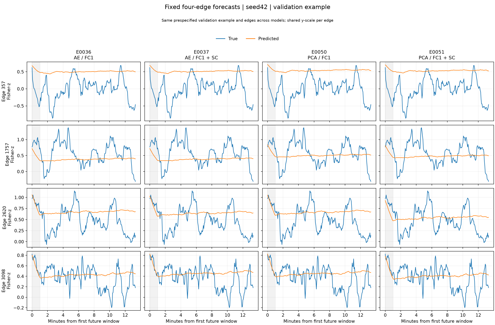

# E0050/E0051 与 E0036/E0037：冻结 FC 编码组件替换

2026-10-27。四项均为 seed42、各自最佳 checkpoint、同一批 158 名验证被试。
E0050/E0051 完成 150 轮，最佳分别为第 7/6 轮；长期区间为原始 FC[18:224]。
本报告不涉及测试集，登记保持 AWAITING_CONCLUSION。

## 主要结果

| 指标 | E0036 AE/FC1 | E0037 AE/FC1+SC | E0050 PCA/FC1 | E0051 PCA/FC1+SC |
| --- | ---: | ---: | ---: | ---: |
| 长期边 MSE ↓ | 0.184294211 | 0.183616821 | 0.186112056 | 0.184912555 |
| 原始 FC 时间 Pearson ↑ | 0.070503424 | 0.070579362 | 0.070456198 | 0.070441976 |
| 去群体模板时间 Pearson ↑ | 0.017518383 | 0.018076057 | 0.017195666 | 0.017053630 |
| 动态残差差分时间 Pearson ↑ | -0.000261361 | -0.000071719 | -0.000471124 | -0.000131181 |
| 动态残差标准差比（理想 1） | 0.001657607 | 0.003285355 | 0.001515608 | 0.002900879 |

上表采用 checkpoint 重放评价值，训练选模 MSE 与之有约 1e-9 的汇总精度差异。
原始 FC 时间相关、去模板时间相关和去解析基线的动态残差差分相关是不同指标；
不能用空间相关性代替时间预测能力。动态残差标准差比远低于 1，四项模型均未
恢复真实的残差波动幅度。动态图中的灰色区域为与首窗重叠的短期区间。

| 配对差（新−参照） | 长期 MSE 差 | 相对变化 | 95% 被试 bootstrap CI | 97.5% 主比较 CI |
| --- | ---: | ---: | --- | --- |
| E0050−E0036 | +0.001817845 | +0.9864% | [-0.000598030, +0.004271740] | [-0.000990763, +0.004648808] |
| E0051−E0037 | +0.001295735 | +0.7057% | [-0.000057019, +0.002585404] | [-0.000256754, +0.002756550] |
| E0051−E0050（次要） | -0.001199500 | -0.6445% | [-0.003226247, +0.000796604] | 不适用 |

按被试配对 bootstrap 10,000 次，seed20261026。两个主要 AE 替换比较额外报告
Bonferroni 97.5% 个别区间；均覆盖零。PCA 替换后没有观察到可靠的长期 MSE
改善；PCA 条件下加入 SC 的 MSE 均值改善也未得到区间支持。E0051 相对 E0037
原始 FC 时间 Pearson 差为 -0.000137385，探索性 95% CI 为
[-0.000250619, -0.000019481]；不能据此作多指标确认性结论。

PCA 同期重建优势没有在本次未来预测中转化为增益。结果限于单 seed、反复
使用的验证集和这套训练协议，不能推断 PCA/AE 的普遍优劣。150 轮末期误差
明显高于早期最佳值，本报告遵循预定选模规则使用 best。

## 可视化







每个 PCA 实验另有四张 PNG：训练概览、与 AE 参照的固定四边动态、动态校准、
分段长程审计。图位于各自 `outputs/E0050/visual/`、`outputs/E0051/visual/`。
固定边来自 `default_rng(42)`，4005 条边中无放回取 4 条并排序；所有模型
使用项目预先固定的同一个验证样本，逐边共享 y 轴。真实蓝色、预测橙色。

## 重现与发布范围

- 主脚本：[build_pca_ae_comparison.py](../../outputs/E0051/visual/build_pca_ae_comparison.py)。
- E0050 入口：[build_e0050_visuals.py](../../outputs/E0050/visual/build_e0050_visuals.py)。
- 汇总值、完整配对区间、审计聚合统计及输入 SHA256：
  [aggregate.json](../../outputs/E0051/visual/E0036_E0037_E0050_E0051_val_aggregate.json)。
- 原始记录：[E0050](E0050_seed42_validation_20261027.md)、
  [E0051](E0051_validation_20261027.json)。

代码与训练配置、A0044 PCA 参数、两项 best/last checkpoint、训练日志、选模
记录和聚合结果随本次结果提交。checkpoint 使用既有 Git LFS 规则。
逐被试 CSV、带被试标识的原始评价 JSON、原始数据清单及私有预测数组留在本地；
公开的曲线图不标注被试编号，也不导出逐被试数值表。
E0048/E0049 及其他独立报告不属于本次提交范围。

重新生成需要已授权的本地验证数据和训练统计。依次对下列 run 执行
`python -m scdfc.cli dynamic-audit --run-id <run> --split val --device cuda`，
再运行主脚本。脚本读取冻结 run 配置，不使用后来修改的实验 YAML。

```text
E0036-s42-20260929T082122Z-b5b871f
E0037-s42-20260929T084843Z-6c70d8a
E0050-s42-20261027T021543Z-bc0af78
E0051-s42-20261027T025607Z-bc0af78
```

环境为 Python3.12.13、PyTorch2.13.0+cu130、RTX5080；保留训练环境记录。
CUDA 注意力反向已有非确定性提示，不声明整个训练逐位可重现。
代码测试全套通过；本次增加 PCA 可视化组件路径回归检查。
